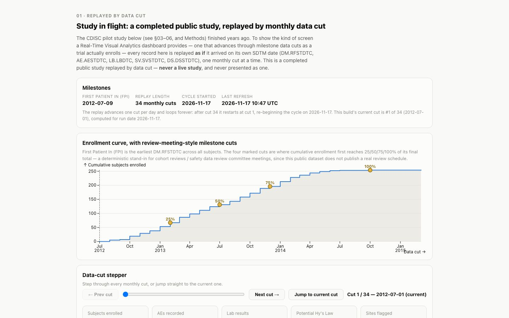
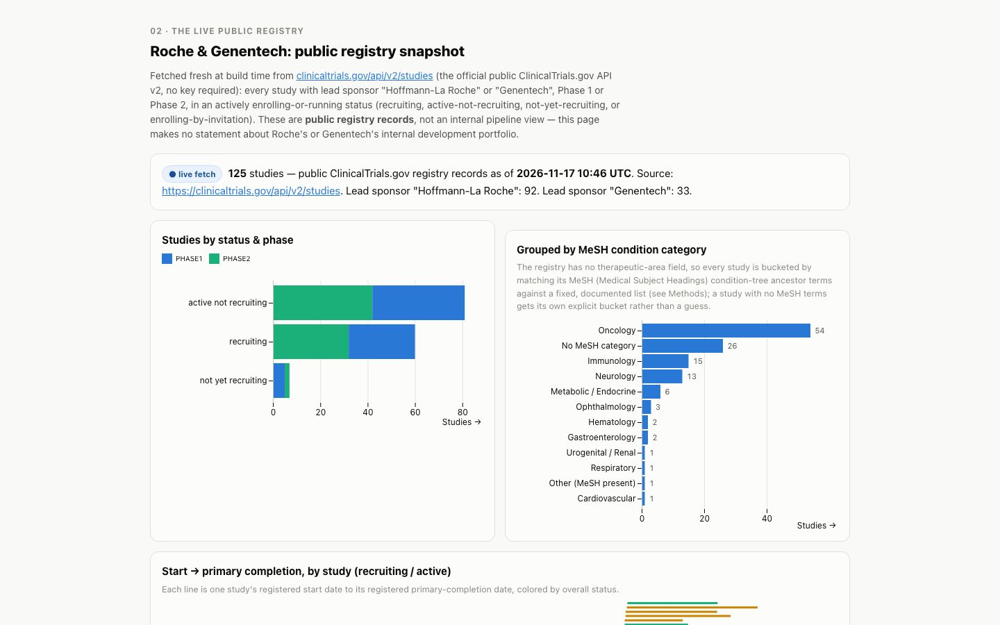
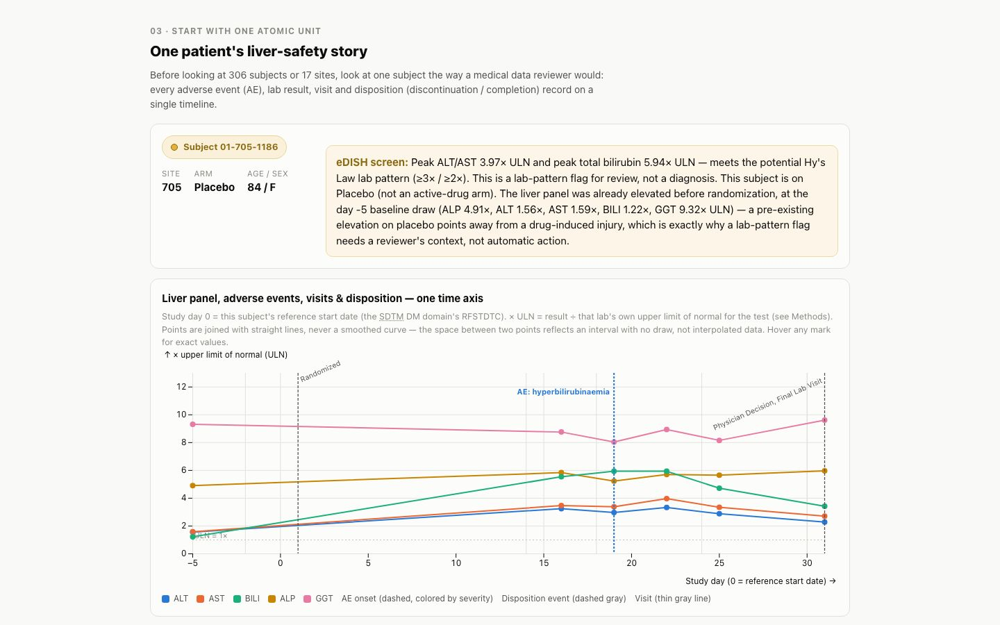
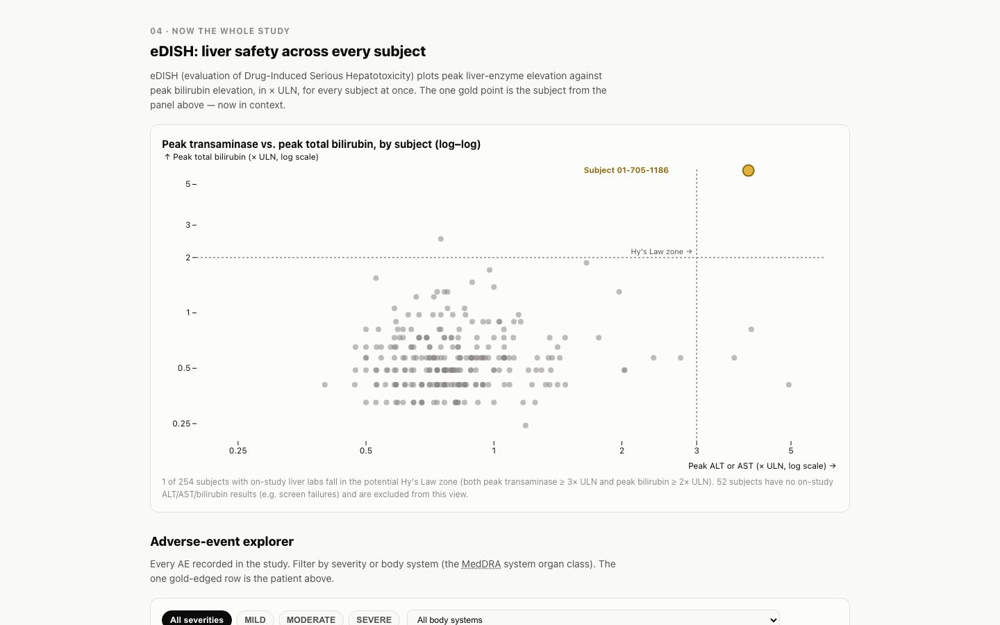
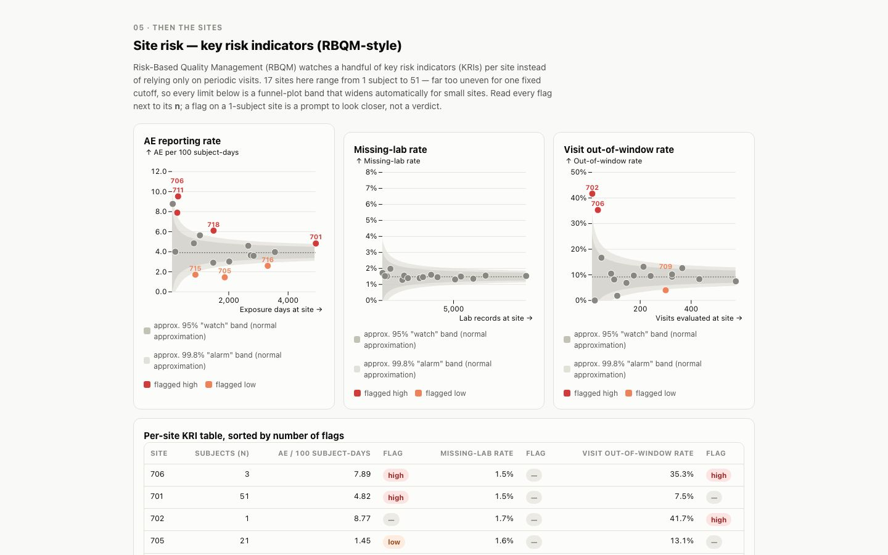
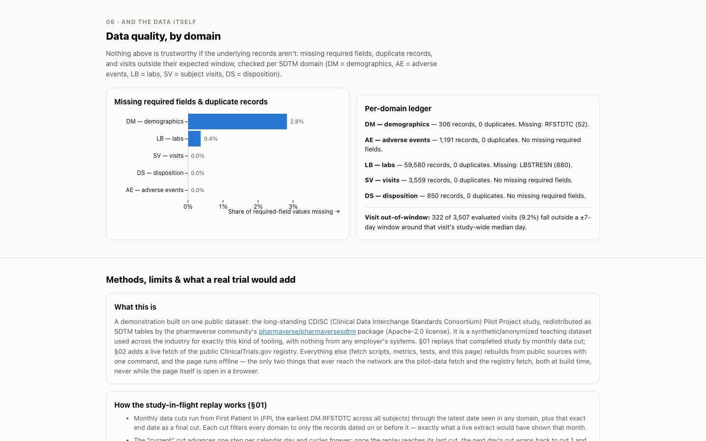
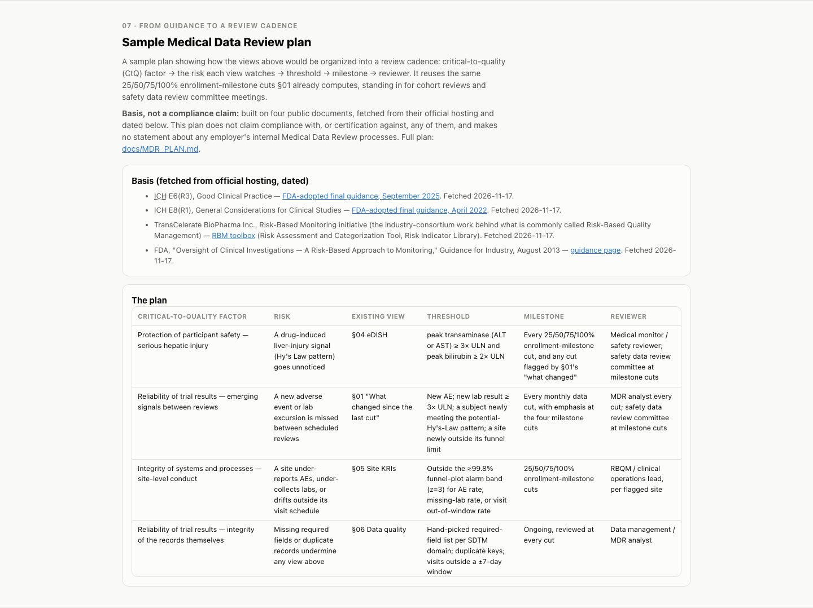
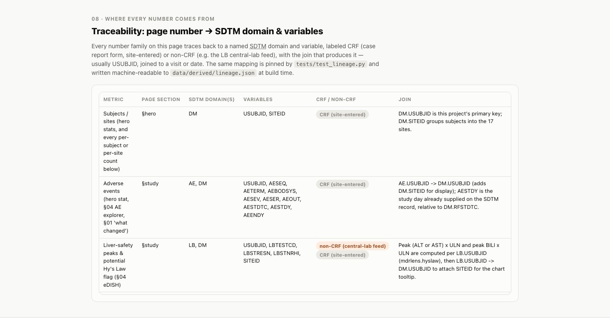
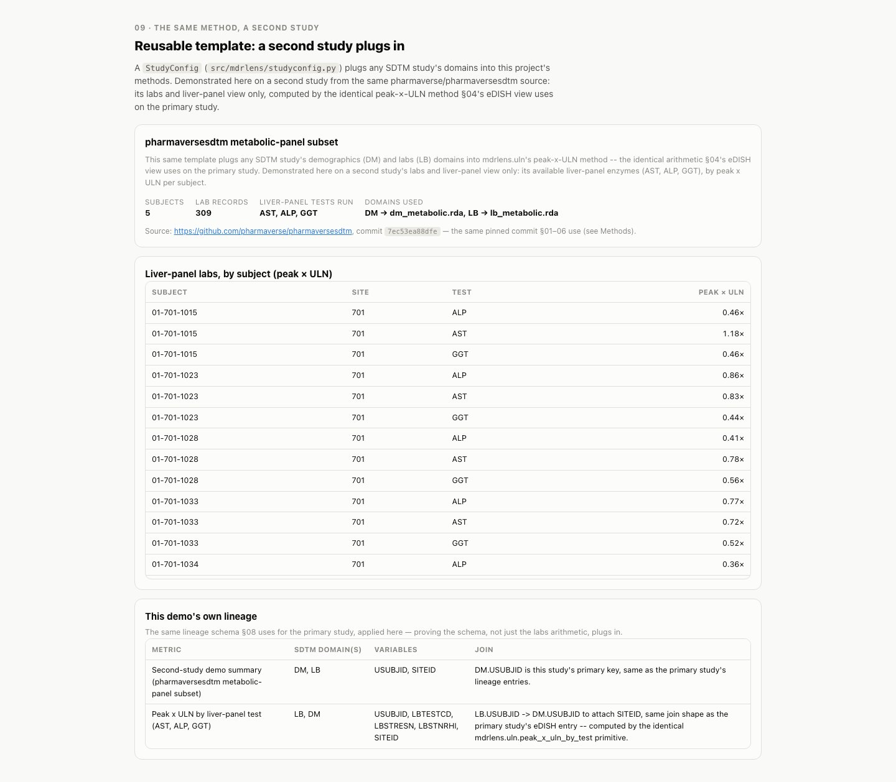

# mdr-lens

**Live demo: https://blehman.github.io/mdr-lens/**

Medical Data Review (MDR, the ongoing clinical review of incoming trial data for
safety issues and data problems) and Real-Time Visual Analytics (RVA, the kind of
interactive study-level dashboard that reviews ongoing early-phase trials against
milestones such as First Patient In, cohort reviews, and safety data review
committee meetings) views, built two ways:

1. **§01 Live study simulator** — one completed public clinical trial, replayed
   by deterministic monthly data cut, with a cut stepper, a "what changed since
   the last cut" view, and an enrollment/milestone screen. Refreshed on a
   schedule (see Live data below); labeled on screen as exactly what it is — a
   simulator built on one completed public study, replayed by data cut.
2. **§02 Live registry** — a live fetch of the public ClinicalTrials.gov registry:
   every Phase 1/2 Roche or Genentech study in an actively enrolling-or-running
   status, grouped by status, phase, and MeSH (Medical Subject Headings) condition
   category, with a start → primary-completion timeline. Public registry records
   only — this makes no statement about either company's internal pipeline.
3. **§03–06** — liver-safety screening (eDISH / Hy's Law), an adverse-event
   explorer with a single-patient timeline, Risk-Based Quality Management (RBQM)
   style site key risk indicators, and data-quality checks, all on the same
   completed study as §01.
4. **§07–09** — a sample Medical Data Review plan built on public ICH/FDA/
   TransCelerate guidance as its basis (`docs/MDR_PLAN.md`), a traceability view
   tying every number above to its source SDTM domain and variables, and a
   reusable study-config template proven on a second study's labs and
   liver-panel view.

Pilot data: the long-standing CDISC (Clinical Data Interchange Standards Consortium)
Pilot Project study, redistributed as SDTM (Study Data Tabulation Model) tables by
the pharmaverse community's [pharmaverse/pharmaversesdtm](https://github.com/pharmaverse/pharmaversesdtm)
package (Apache-2.0 license). It is a public, synthetic/anonymized teaching dataset
used across the industry for exactly this kind of tooling practice: 306 subjects,
17 sites, 1,191 adverse events, 59,580 lab results. No data here comes from any
real patient, and none of it is related to any employer's systems.

## Live data

- **Live study simulator (§01)**: `scripts/build.py` recomputes the "current" data
  cut from the run date every time it runs (see `src/mdrlens/cuts.py`) — there is
  no stored pointer, so nothing about this needs a daily commit. The default
  "current" cut loops over the cuts from the 25% enrollment milestone to the last
  cut; after the last cut it wraps back to the 25% cut. Every cut from #1 stays
  reachable one at a time with the on-page stepper.
- **Registry (§02)**: `scripts/fetch_registry.py` talks to
  `https://clinicaltrials.gov/api/v2/studies` (public, no key) and writes
  `data/derived/registry_summary.json`. It fails loudly (non-zero exit) and leaves
  the last good file in place on ANY failure — network error, bad response shape,
  or zero studies back.
- **Scheduled refresh**: `.github/workflows/refresh.yml` runs both fetches plus the
  build and test steps daily, then deploys the freshly built `web/` directly to
  Pages **without committing anything** to the repository. If either fetch fails,
  the job fails before the deploy step runs, so Pages keeps serving the previous
  deployment. See that file's comments for the GitHub policy on scheduled
  workflows in public repos going dormant after 60 days of no repo activity, and
  how this project's design handles that without a daily commit.


## Screenshots

| Live study simulator (§01) | Live registry (§02) |
|---|---|
|  |  |
| **One patient** | **The whole study (eDISH)** |
|  |  |
| **The sites (RBQM-style KRIs)** | **Data quality** |
|  |  |
| **Sample MDR plan (§07)** | **Traceability / lineage (§08)** |
|  |  |
| **Reusable template: a second study (§09)** | |
|  | |

Phone layouts: `docs/screenshots/iphone14_0*.jpg`.

## What it is

One static HTML page (`web/index.html`, D3 + Observable Plot, both vendored, so
nothing ever reaches the network while the page itself is open) plus a small
Python package that computes everything the page shows, and two fetch scripts
that run at build time. The page is built "monad"-style: it starts with the
replay and the live registry, then one patient, then widens to the whole study,
then to the 17 sites, then to the data itself — never a dashboard grid of
unrelated tiles.

1. **Live study simulator** (§01) — the completed pilot study replayed by monthly
   data cut: a cut stepper, First Patient In and an enrollment curve with
   review-meeting-style milestones, and a "what changed since the last cut" view
   (new AEs, new ≥3× ULN lab excursions, newly flagged potential Hy's Law
   subjects, sites newly outside a funnel limit).
2. **Live registry** (§02) — Roche + Genentech, Phase 1/2, actively
   enrolling-or-running studies on the public ClinicalTrials.gov registry: counts
   by status × phase, grouped by MeSH condition category, and a start →
   primary-completion timeline.
3. **One patient** — a single subject's adverse events, lab results, visits, and
   disposition (discontinuation/completion) on one time axis, the way a reviewer
   would actually read a case before looking at aggregates.
4. **Whole study — eDISH** (evaluation of Drug-Induced Serious Hepatotoxicity) —
   peak liver enzyme (ALT/AST) vs. peak bilirubin, both in × ULN (upper limit of
   normal: a lab result ÷ that lab's own normal-range ceiling, so different labs'
   units are comparable), log–log, with Hy's Law reference lines. Hy's Law is
   Hyman Zimmerman's observation that enzyme elevation *and* bilirubin elevation in
   the same patient predicts serious liver injury; "potential Hy's Law" is the
   lab-only screening pattern used here (≥3× ULN enzyme and ≥2× ULN bilirubin) to
   flag candidates for a reviewer, not a diagnosis.
5. **Whole study — adverse-event explorer** — every AE (adverse event), filterable
   by severity and MedDRA (Medical Dictionary for Regulatory Activities) body
   system, with the one-patient subject highlighted in context.
6. **Sites — RBQM-style key risk indicators (KRIs)** — per site: AE reporting rate,
   missing-lab rate, and visit out-of-window rate, each checked against a
   funnel-plot band that widens for small sites (gsm-style, see Prior art), with
   site size (n) shown beside every flag.
7. **Data quality** — missing required fields, duplicate records, and
   out-of-window visits, per SDTM domain.

## What each view answers for a reviewer

- *Is any subject showing the lab pattern that predicts serious drug-induced liver
  injury?* — the eDISH view.
- *What happened to this subject, in order, across every data source at once?* —
  the one-patient timeline.
- *What adverse events has the study seen, and does this one look unusual for its
  body system or severity?* — the AE explorer.
- *Is any site behaving differently enough from the rest of the study to warrant a
  closer look — accounting for the fact that a 1-subject site and a 51-subject
  site can't be held to the same bar?* — the site KRI view.
- *Can the numbers above even be trusted, given what's missing or duplicated in the
  source data?* — the data-quality view.

## CRF vs. non-CRF data

A CRF (case report form) is the form — paper or electronic — a trial site fills
out to record a subject's visit: adverse events, concomitant medications, physical
exam findings. Non-CRF data arrives by other routes: central lab results, ECG
(electrocardiogram) readings, imaging — typically a data feed from a vendor rather
than something a site coordinator types in. A real Medical Data Review workflow
reconciles both: a lab value from the non-CRF feed and an adverse event the site
entered on a CRF should tell a consistent story (e.g. a severe lab abnormality
with no matching AE entered is itself a data-quality flag). This project's SDTM
domains already carry that distinction (LB is lab, i.e. non-CRF data; AE is
CRF-entered) but doesn't reconcile the two against each other end to end — a real
EDC (Electronic Data Capture) system and query workflow would.

## Medical Data Review plan, traceability & reusable template (§07–09)

- **§07 Sample Medical Data Review plan** (`docs/MDR_PLAN.md`) — a sample plan
  mapping critical-to-quality factor → the risk each existing view watches →
  threshold → milestone (reusing §01's own 25/50/75/100% enrollment-milestone
  cuts) → reviewer, built on four public documents as its basis: ICH E6(R3)
  (Good Clinical Practice), ICH E8(R1) (General Considerations for Clinical
  Studies), TransCelerate's Risk-Based Monitoring / Risk-Based Quality
  Management toolkit, and FDA's 2013 risk-based monitoring guidance — each
  fetched from its official hosting and dated in that document. It is a
  sample, not a validated or regulatory-submitted plan, and claims no
  compliance with or certification against any of those sources.
- **§08 Traceability** — every number family on the page, mapped to its
  source SDTM domain and variables, labeled CRF (site-entered) or non-CRF
  (e.g. the LB central-lab feed), with the join that produces it. The same
  mapping (`src/mdrlens/lineage.py`) is pinned by `tests/test_lineage.py` and
  written machine-readable to `data/derived/lineage.json` at build time.
- **§09 Reusable template** — a `StudyConfig` (`src/mdrlens/studyconfig.py`)
  names which SDTM domains a study supplies, which liver-panel tests its LB
  domain actually ran, and which domains are CRF vs. non-CRF. It plugs any
  SDTM study into `mdrlens.uln.peak_x_uln_by_test` — the same arithmetic §04's
  eDISH view uses — and is demonstrated here on a second study from
  pharmaversesdtm: its "metabolic" demographics and labs subset (5 subjects),
  rendering the labs and liver-panel view only (its available AST, ALP and
  GGT liver-panel tests, by peak × ULN per subject). Fetch and build it with
  `uv run python scripts/fetch_second_study.py && uv run python scripts/build_second_study.py`;
  pinned by `tests/test_studyconfig.py` and `tests/test_second_study.py`.

## Prior art (read and cited; no code copied)

- [Gilead-Public/gsm](https://github.com/Gilead-Public/gsm) (Good Statistical
  Monitoring, Apache-2.0) — the RBQM key-risk-indicator and funnel-plot method the
  site view here follows.
- [pharmaverse/teal](https://github.com/insightsengineering/teal) — Roche/Genentech's
  open-source clinical data exploration framework.
- [SafetyGraphics/safetyGraphics](https://github.com/SafetyGraphics/safetyGraphics)
  — the eDISH / Hy's Law graphic convention this project's liver-safety view
  follows.

## Honesty about the statistics

17 sites is a thin population for process-control rules, and this study's sites
range from 1 subject to 51 — a single fixed cutoff applied to a raw rate would be
meaningless for the small ones. Every KRI limit here is a funnel-plot band (normal
approximation: a pooled study-wide rate ± 2 or 3 standard errors, with the standard
error shrinking as a site's own denominator grows) so the band narrows for big
sites and flares open for small ones, and every flag in the page and the table is
shown next to that site's **n**. A flag on a 3-subject site is a prompt to look
closer, not a finding. This is also a normal-approximation shortcut, not the exact
binomial/Poisson method or the multiplicity correction a real RBQM program (e.g.
gsm) would use — see Limits below.

§03–06 are a look back at **one already-completed pilot study**: those views do
not change cut to cut, and the page says so. §01 (the Live study simulator)
replays that same completed study by data cut, refreshed on a schedule — labeled
on screen plainly as a simulator and a replay, never as an ongoing trial.

## What a real trial would add

- A live EDC/CRF feed, refreshing continuously, instead of one static,
  already-closed dataset.
- The EX (drug exposure) domain for real dosing dates, instead of the DM
  (demographics) domain's reference start/end dates used here as a stand-in for
  exposure duration.
- A published protocol visit schedule with real visit windows, instead of the
  ±7-day window around each visit's study-wide median day used here as a proxy.
- A query workflow — raising a data query against a site, tracking it to
  resolution, and re-running these KRIs — which this static page has no mechanism
  for.
- Formal validation against a define.xml and the study's own CDISC conformance
  rules, not the hand-picked "required field" list used here.
- Exact (not normal-approximation) funnel limits, multiplicity correction across
  many simultaneous KRIs, and clinical adjudication of every flag by a reviewer.

## How to run it

```sh
uv venv .venv && source .venv/bin/activate
uv pip install -e ".[dev]"

# fetch the public pilot data + a fresh registry snapshot, rebuild every derived
# number (including the current data cut, recomputed from today's date), and
# re-run every check (independent recounts in tests/test_independent_recount.py
# and tests/test_study_in_flight_recount.py)
uv run python scripts/fetch_data.py && uv run python scripts/fetch_registry.py && \
  uv run python scripts/build.py && uv run pytest
```

Then open `web/index.html` directly in a browser — no server needed, and no
network calls happen while it's open. `scripts/fetch_data.py` downloads the five
SDTM domains used here (`dm`, `ae`, `lb`, `sv`, `ds`) to `data/raw/` (gitignored)
and records the source URL and a sha256 of every file in `data/manifest.json`.
`scripts/fetch_registry.py` fetches the live ClinicalTrials.gov registry snapshot
to `data/derived/registry_summary.json`, failing loudly and leaving the last good
file in place if anything goes wrong. `scripts/build.py` computes every number on
the page (including the §01 cut replay and the §08 traceability lineage) from
those files and writes the small derived JSON in `data/derived/` plus
`web/data.js` (the bundle the page loads).

§09's reusable-template demo is a one-time proof, not part of the command above
(see "Medical Data Review plan, traceability & reusable template" above): run
`uv run python scripts/fetch_second_study.py && uv run python scripts/build_second_study.py`
to regenerate it from the second study's own raw SDTM subset; its derived JSON
is committed as a static demo, same as §03–06's look back at the primary study.

## QA

`tests/` is plain pytest (`uv run pytest`), including hand-checked × ULN math
against real values from one subject, the independent recount above, the
§08 lineage mapping (`tests/test_lineage.py`), and the §09 reusable-template
demo (`tests/test_studyconfig.py`, `tests/test_second_study.py`). The page
was opened in Playwright under Chromium (1440×900) and WebKit/iPhone 14 (390×844);
screenshots are in `docs/screenshots/`, zero browser console errors on either.

## Limits

- §01's replay and §02's registry are refreshed on a schedule, not pushed to the
  browser continuously; a real RVA dashboard connects to a live EDC/CRF feed, not
  a scheduled re-fetch of a public source. §03–06 are a fixed look at one
  completed study and do not change cut to cut.
- 52 of 306 subjects in the pilot study are screen failures with no DM.RFSTDTC
  (no reference start date), and a further 26 AE / 225 LB records have no
  parseable onset/collection date; neither group has a date to be placed on the
  §01 cut timeline, so both are correctly excluded from every cut's
  enrolled/cumulative counts while still counted in the whole-study totals
  elsewhere on the page.
- The "required field" list per domain, the ±7-day visit window, and the KRI
  thresholds are reasonable choices for a demo, not a validated clinical
  monitoring plan. The MeSH-category mapping in §02 is a fixed, documented
  bucket list, not an official therapeutic-area taxonomy.
- Built on a public teaching dataset, so the views show method and design rather
  than findings about any real therapy. §02's registry counts move daily; tests
  pin the query shape and response schema, never a specific count.
